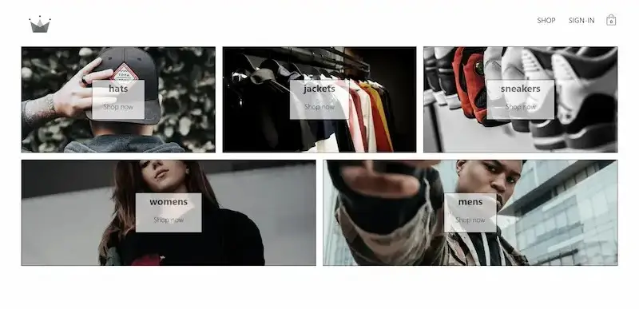
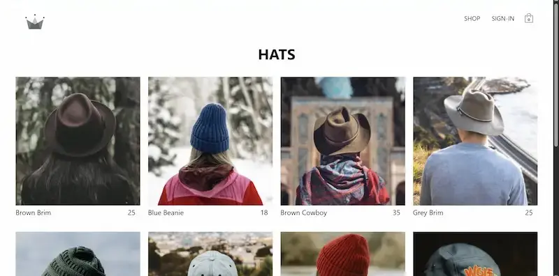
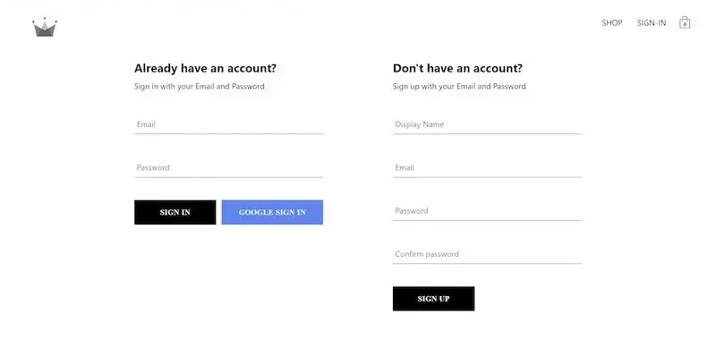
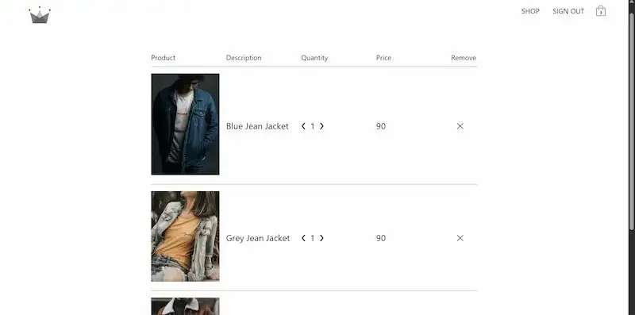

# Pookie Clothing

E-commerce web app where users browse products by category, sign in with email or Google, and manage a cart.

**Live demo:** https://pookie-clothing-alpha.vercel.app

## Tech stack
React, Redux Toolkit, redux-persist, TypeScript, Firebase Auth, Cloud Firestore, React Router, styled-components, Sass, Vercel

## Features
- Email and Google sign-in
- Product catalogue loaded from Firestore
- Shopping cart
- Nested category routes

## Performance
Lighthouse mobile performance improved from 71 to 84 and LCP from 8.1 s to 2.7 s using WebP images, lazy-loaded routes and an LCP image preload.

## Run locally
    yarn install
    yarn start

## Screenshots

